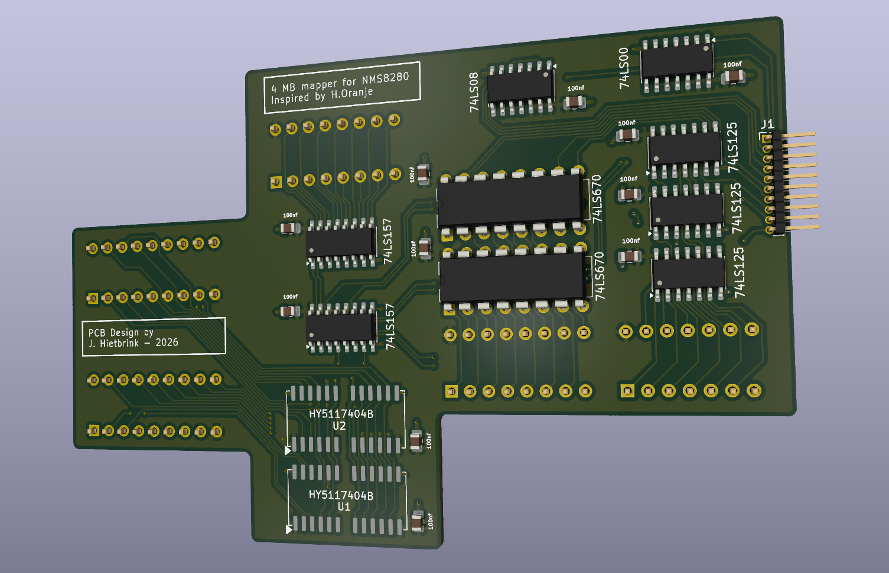
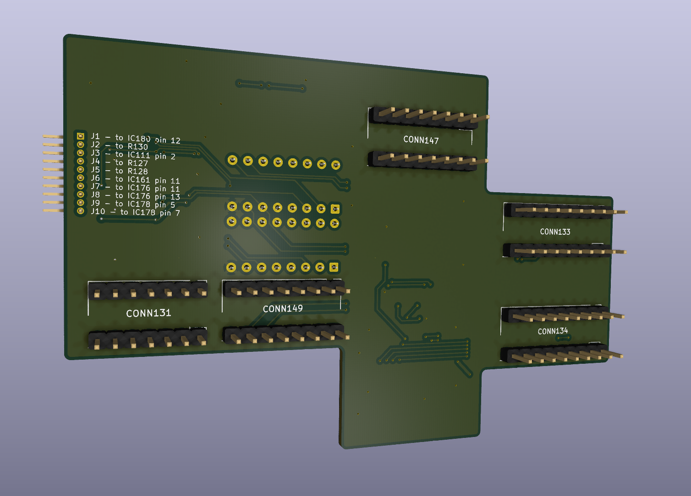

# Philips NMS 8280 MSX2 4 MB Memory Mapper

A low-profile PCB implementation of the 4 MB memory mapper for the Philips NMS 8280 MSX2, based on the original design by Hans Oranje. The board is intended to replace the stock memory while keeping the mapper at slot 3.2, with the required connections and piggybacking arranged on the PCB instead of a large wiring harness.

> **Prototype warning:** This design has not been verified for production use. Confirm mechanical fit and electrical operation on the prototype before building or using the board.

## Contents

- [Board images](#board-images)
- [Design files](#design-files)
- [Bill of materials](#bill-of-materials)
- [Manual](#manual)
- [References and datasheets](#references-and-datasheets)

## Board images

Front of the PCB:

Back of the PCB:

Additional views: [connector J1](./img/j1.png), [cutout diagram](./img/cutout_schema.png), and [annotated cutout diagram](./img/cutout_schema_marked.png).

## Design files

- [KICAD](./KICAD/) contains the main schematic, PCB layout, and project files.
- [kicad_alll_smd](./kicad_alll_smd/) contains the all-SMD PCB variant and its project files.
- [Gerber manufacturing files](./gerber/) are provided at the repository root.

The design aims to replace the stock memory without occupying an expanded slot, keep the profile low for fit, avoid wiring sprawl, and make reverting to the original hardware straightforward.

## Bill of materials

- [Main PCB interactive BOM](./KICAD/bom/ibom.html)
- [All-SMD PCB interactive BOM](./kicad_alll_smd/bom/ibom.html)

## Manual

Assembly and installation instructions are a work in progress.

## References and datasheets

- [Hans Oranje's original 4 MB mapper paper (Dutch)](./doc/4mbnms8280.pdf)
- [Philips NMS 8280 service manual](./doc/nms8280_service_manual.pdf)
- [HY5117404B RAM datasheet](./doc/HY5117404B.pdf)
- [SN74LS00 datasheet](./doc/SN74LS00.pdf)
- [SN74LS08 datasheet](./doc/SN74LS08.pdf)
- [SN74LS125 datasheet](./doc/SN74LS125.pdf)
- [SN74LS157 datasheet](./doc/SN74LS157.pdf)
- [SN74LS670 datasheet](./doc/SN74LS670.pdf)

The RAM is an HY5117404B, represented by the custom `HYB5117400BJ` symbol in the schematic. The custom `1464` symbol does not identify a manufacturer part number, so its exact component cannot be determined from the schematic alone.
