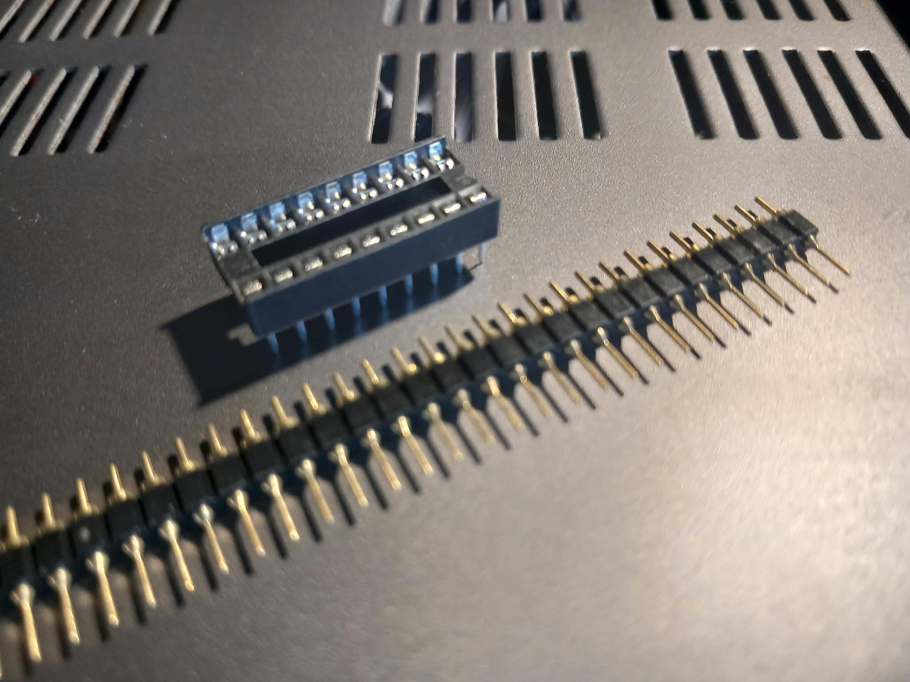
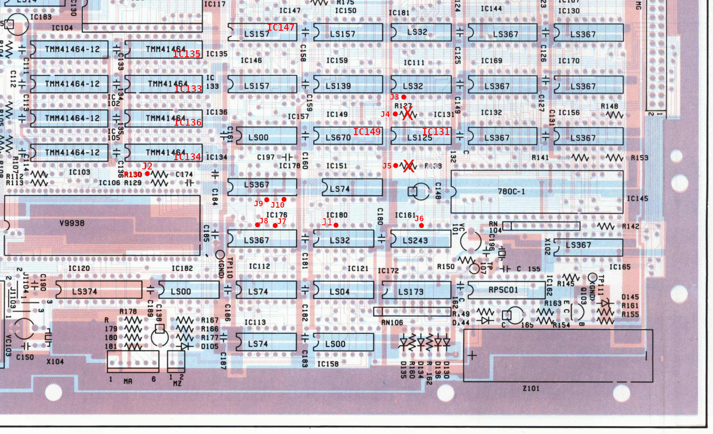
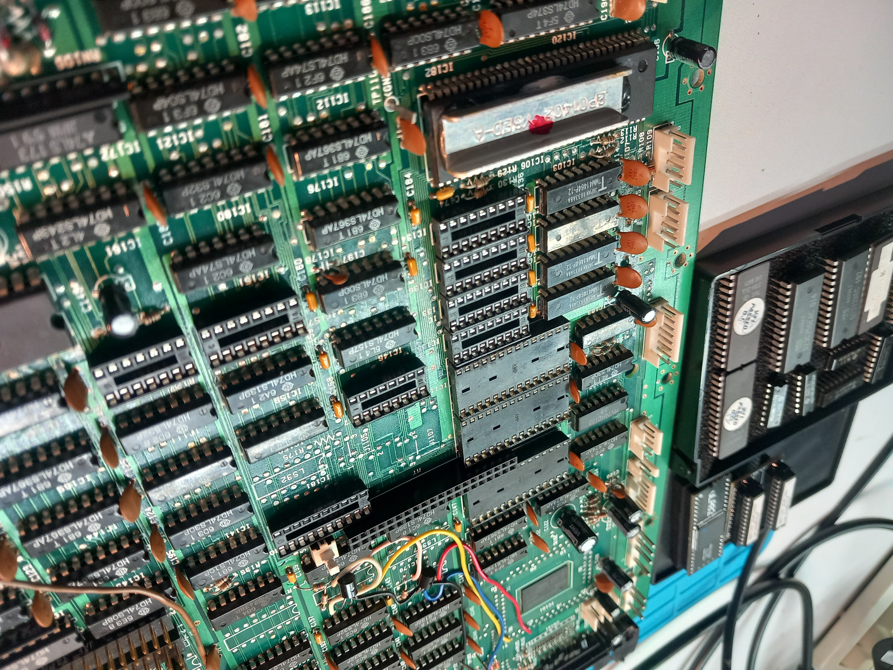
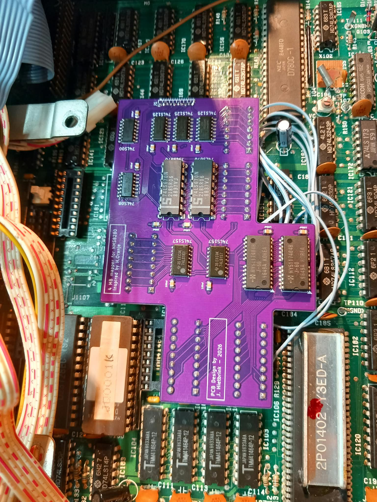
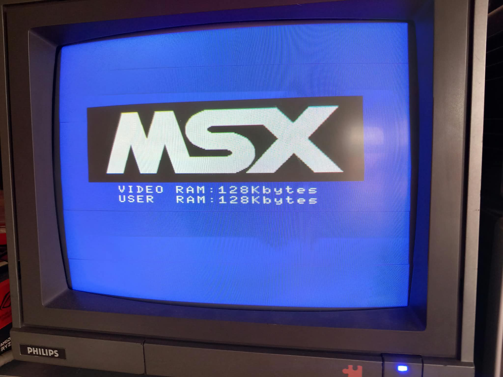
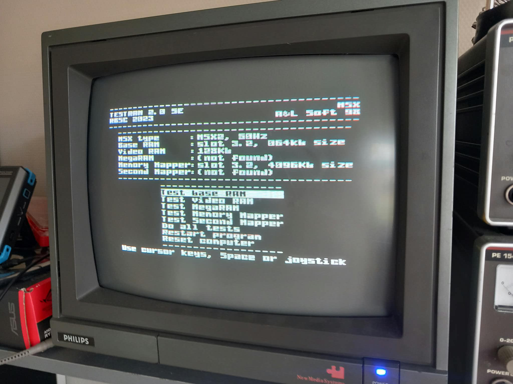
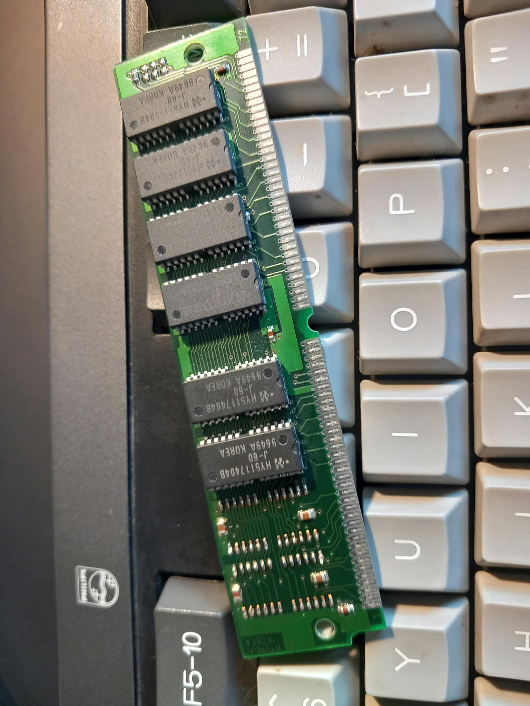

# Philips NMS 8280 MSX2 4 MB Memory Mapper

A low-profile PCB implementation of the 4 MB memory mapper for the Philips NMS 8280 MSX2, based on the original design by Hans Oranje. The board is intended to replace the stock memory while keeping the mapper at slot 3.2, with the required connections and piggybacking arranged on the PCB instead of a large wiring harness.
 
 

## Contents

- [Design files](#design-files)
- [Bill of materials](#bill-of-materials)
- [Manual](#manual)
- [Result & test](#result--test)
- [Issues](#issues)
- [References and datasheets](#references-and-datasheets)

Additional views: [connector J1](./img/j1.png), [cutout diagram](./img/cutout_schema.png), and [annotated cutout diagram](./img/cutout_schema_marked.png).
 
 

## Design files

- [KICAD](./KICAD/) contains the main schematic, PCB layout, and project files.
- [Gerber manufacturing files](./gerber/) are provided at the repository root.
 
 

## Bill of materials

Use LS or HCT logic IC's.

The Hyundai RAM used by this design is just wat I found in my drawer. It came of a 16 MB 72pins FPM module. 
Any 4Mx4 DRAM / FPM layout will work. I used 60ns against the 120ns original RAM without, any problems.

- [Main PCB interactive BOM](./KICAD/bom/ibom.html)
- [All-SMD PCB interactive BOM](./kicad_alll_smd/bom/ibom.html)

 
 

## Manual

Use the cutout image as a reference for component locations. The J1 wiring points are marked with a red dot and the corresponding wire number.

### Prepare the mainboard

- Remove the memory ICs IC133, IC134, IC135, and IC136, and replace them with DIP sockets. Only IC133 and IC134 require sockets, but socketing all original memory locations is recommended in case you need to restore the stock configuration.
- Remove logic ICs IC147, IC149, and IC131, and replace them with DIP sockets.
- Remove R127 and R128 (100 ohms). They are located at the red X marks in the image.

 
 

### Prepare the drop-in 4 MB PCB

- Assemble all SMD components.
- Cut the required rounded pins to size for CONN133, CONN134, CONN147, CONN149, and CONN131.
- **Do not solder the pins to the board yet.**
 
 

### Test-fit on the mainboard

- Fit the rounded pins into the corresponding sockets on the mainboard.
- Fit the drop-in PCB over the pins on the corresponding connectors and sockets. Although measurements were taken twice after prototyping, a slight offset remains. Larger sockets and smaller rounded pins provide some room for error.
- When all pins are in place and the PCB is straight and level, tack the outermost pins at the corners of the sockets to hold them in place. Keep heating time as short as possible.
- Remove the PCB with the partially soldered pins from the mainboard.
- Finish soldering the remaining pins, then solder IC149 and IC149B1.
 
 

### Connector J1 wiring

Use 30 AWG wire, or strip a floppy-disk/IDE ribbon cable.

| J1 pin | Connect to |
| --- | --- |
| J1 | IC180 pin 12 |
| J2 | R130, left leg when facing the mainboard as shown in the cutout image |
| J3 | IC111 pin 11 |
| J4 | R127, left pinhole when facing the mainboard as shown in the cutout image |
| J5 | R128, left pinhole when facing the mainboard as shown in the cutout image |
| J6 | IC161 pin 11 |
| J7 | IC176 pin 11 |
| J8 | IC176 pin 13 |
| J9 | IC178 pin 5 |
| J10 | IC178 pin 7 |
 
 

## Result & test

Plug in the finished PCB, carefully arranging the wires so they do not get trapped between the pin headers and DIP sockets. Power on the computer. With the stock ROM, the boot screen should report 128 KB of user RAM. Run a RAM checker to verify all 4096 KB.

 
 

## Issues

- The 1 mm connector J1 footprint is small for comfortable hand soldering.
- Silkscreen text could be a few pixels larger.
 
 

## References and datasheets

- [Hans Oranje's original 4 MB mapper paper (Dutch)](./doc/4mbnms8280.pdf)
- [Philips NMS 8280 service manual](./doc/nms8280_service_manual.pdf)
- [HY5117404B RAM datasheet](./doc/HY5117404B.pdf)
- [SN74LS00 datasheet](./doc/SN74LS00.pdf)
- [SN74LS08 datasheet](./doc/SN74LS08.pdf)
- [SN74LS125 datasheet](./doc/SN74LS125.pdf)
- [SN74LS157 datasheet](./doc/SN74LS157.pdf)
- [SN74LS670 datasheet](./doc/SN74LS670.pdf)

The RAM is an HY5117404B, represented by the custom `HYB5117400BJ` symbol in the schematic. The custom `1464` symbol does not identify a manufacturer part number, so its exact component cannot be determined from the schematic alone.

